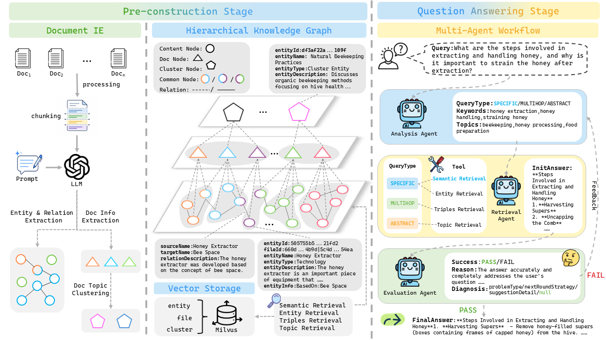

````markdown
# HKG-RAG

**HKG-RAG** (Hierarchical Knowledge Graph with Retrieval-Augmented Generation) is a retrieval-augmented question-answering framework designed for private-domain documents, integrating **hierarchical knowledge graphs, multi-granularity retrieval, and multi-agent collaboration**.

HKG-RAG organizes documents into a hierarchical knowledge structure consisting of an **entity layer, document layer, and topic cluster layer**, and dynamically selects document chunk retrieval, entity retrieval, triple retrieval, and topic retrieval according to different query types, thereby improving knowledge coverage and multi-hop reasoning capabilities in complex question-answering scenarios.

## Framework

The overall framework of HKG-RAG is shown below:



## Technology Stack

| Category | Technology |
|---|---|
| Programming Language | Java 17 |
| Backend Framework | Spring Boot 3.5.5, Spring AI 1.1.7 |
| Vector Database | Milvus 2.6.8 |
| Graph Database | Neo4j |
| Large Language Model | Qwen2.5-14B-Instruct |
| Embedding Model | Qwen3-Embedding-4B |
| Model Inference Service | vLLM |

## Requirements

- **JDK 17+**
- **Maven 3.6+**
- **Milvus 2.6+**
- **Neo4j 5.x**
- **LLM Service**: Qwen2.5-14B-Instruct
- **Embedding Service**: Qwen3-Embedding-4B

## Quick Start

### 1. Clone the Repository

```bash
git clone https://github.com/WJQ-7/HKG-RAG.git
cd HKG-RAG
```

### 2. Configuration

Modify `src/main/resources/application.properties` and configure the model services, databases, and related parameters according to your deployment environment.

```properties
# Server
server.port=8080

# Prompt language: zh | en
HKG-RAG.prompt.lang=en


# Milvus
# Vector database connection address
milvus.host=127.0.0.1
milvus.port=19530


# Neo4j
# Used to store entities, documents, topic nodes, and their relationships in the hierarchical knowledge graph
spring.neo4j.uri=bolt://localhost:7672
spring.neo4j.authentication.username=neo4j
spring.neo4j.authentication.password=<YOUR_PASSWORD>


# Qwen LLM
# Main large language model service used by HKG-RAG
HKG-RAG.llm.qwen.base-url=http://localhost:8001
HKG-RAG.llm.qwen.api-key=<YOUR_API_KEY>
HKG-RAG.llm.qwen.model=/path/to/qwen2.5-14b-instruct


# DeepSeek LLM
# Used for model evaluation
HKG-RAG.llm.deepseek.base-url=https://api.deepseek.com
HKG-RAG.llm.deepseek.api-key=<YOUR_API_KEY>
HKG-RAG.llm.deepseek.model=<MODEL_NAME>


# Embedding
# Used to generate vector representations of documents, entities, and topics
HKG-RAG.embedding.base-url=http://localhost:8002
HKG-RAG.embedding.api-key=<YOUR_API_KEY>
HKG-RAG.embedding.model=/path/to/qwen3-embedding-4b


# Chunk
# Document chunk size and overlap length between adjacent chunks
HKG-RAG.chunk.max-size=1024
HKG-RAG.chunk.overlap-chunk-size=128


# Retrieval
# Retrieval weights and number of recalled candidates
HKG-RAG.retrieval.EXACT-WEIGHT=0.5
HKG-RAG.retrieval.BM25-WEIGHT=0.5
HKG-RAG.retrieval.VECTOR_WEIGHT=0.5
HKG-RAG.retrieval.TopK=5


# Agent
# Maximum number of tool-calling rounds and token budget allowed for a single query
HKG-RAG.agent.max-tool-rounds=6
HKG-RAG.agent.max-total-tokens=24000


# Milvus Collections
# Configure the actual Collection names used for entities, documents, and topic clusters
HKG-RAG.milvus.Entity-Collection=<ENTITY_COLLECTION_NAME>
HKG-RAG.milvus.File-Collection=<FILE_COLLECTION_NAME>
HKG-RAG.milvus.Cluster-Collection=<CLUSTER_COLLECTION_NAME>
```


### 3. Data Preparation

Place the raw documents in:

```
src/main/resources/documents/
```

## Pipeline


### Stage 1: Document Preprocessing
HKG-RAG provides two document extraction methods.

#### Method 1: Extract Documents Using the Python Script
A Python document parsing script is provided at:
```text
src/main/resources/scripts/DocParser.py 
```
The script recursively reads raw documents from the specified directory and converts their content into a unified JSON format.
First, install the required Python dependencies:
```bash 
pip install "markitdown[all]" 
``` 
To parse legacy `.doc` files, also install:
```bash 
pip install textract 
```
 Run the script with:
 ```bash 
 python src/main/resources/scripts/DocParser.py <input_document_directory> <output_json_path> 
 ```


#### Method 2: Extract Documents Using Java
```text
src/test/java/com/bistu/hkgrag/WorkFlow/DocPreprocess.java
├── @Order(1) docParser()    # Extract all documents under documents/
└── @Order(2) fileChunk()    # Split documents into chunks

### Stage 2: Document Extraction


```
### Stage 2: Document Extraction
```text
src/test/java/com/bistu/hkgrag/WorkFlow/ExtractionServiceTest.java
├── @Order(1) testExtractionService()   # Use LLM to extract entities, attributes, and relations
├── @Order(2) testFileTopicExtraction() # Use LLM to extract document topics
└── @Order(3) test_topicCluster()       # Generate topic nodes
```


### Stage 3: Database Construction
Database construction includes two parts: **Milvus vector database construction** and **Neo4j knowledge graph construction**.

Related code:
```text
src/test/java/com/bistu/hkgrag/WorkFlow/DBServiceTest.java
```
#### 3.1 Milvus Vector Database Construction

Run the following methods in `@Order` sequence:
| Step | Content                           |
|---|------------------------------|
| `@Order(1)` | `testMilvusInsertContentEntities()`| Insert content entities into the Milvus **entity collection** |
| `@Order(2)` | `testMilvusInsertDocumentEntities()`| Insert document entities into the Milvus **file collection** |
| `@Order(3)` | `testMilvusInsertClusterEntities()`| Insert cluster entities into the Milvus **cluster collection** |
| Subsequent steps | Insert entity nodes and relations into Neo4j to construct the HKG |

#### 3.2 Neo4j Knowledge Graph Construction

After completing the Milvus data insertion, continue running the following methods in `@Order` sequence:
| Step | Method | Input Data | Function |
|---|---|---|---|
| `@Order(4)` | `test_insertEntities()` | Insert entity nodes into Neo4j |
| `@Order(5)` | `test_createRelations()`| Create relationships between entities in Neo4j |

### Stage 4: Evaluation

#### 4.1 BISTU-OfficeQA Dataset Evaluation

Related code:
```text
src/test/java/com/bistu/hkgrag/Evaluation/Evaluation.java
```
The evaluation data is located at:

```text
src/main/resources/data/datasets/Bistu/qa.jsonl
```

Run `runAllMethods()`, which performs the following steps:

| Step | Content |
|---|---|
| Step 1 | Use NaiveRAG and HKG-RAG to generate answers for the test set |
| Step 2 | Save the QA results generated by each method |
| Step 3 | Compute EM, F1, ROUGE-L, and Recall |
| Step 4 | Generate evaluation results and comparison summaries for all methods |

The evaluation can also be run step by step:

| Method | Function |
|---|---|
| `testSet()` | Use HKG-RAG to generate answers for the BISTU-OfficeQA test set |
| `evaluation()` | Compute automatic evaluation metrics for existing QA results |
| `testAssessService()` | Use an LLM to evaluate existing question-answering results |
| `runAllMethods()` | Run answer generation, metric evaluation, and result aggregation for multiple RAG methods |

#### 4.2 UltraDomain Dataset Evaluation

The UltraDomain dataset provides an independent end-to-end pipeline. The related code is located at:

```text
src/test/java/com/bistu/hkgrag/WorkFlow/UltraDomainPipeline.java
```

The following four sub-datasets are currently supported:

```text
agriculture
cs
legal
mix
```

`UltraDomainPipeline` divides data processing, database construction, and evaluation into three stages:

| Stage | Method | Content |
|---|---|---|
| Stage 1 | `stage1_Extraction()` | Document chunking, topic extraction, entity-relation extraction, and topic clustering |
| Stage 2 | `stage2_DatabaseBuild()` | Construct the Milvus vector database and Neo4j knowledge graph |
| Stage 3 | `stage3_Evaluation()` | Run different RAG methods on the QA dataset and generate evaluation results |

Each dataset provides corresponding stage-specific entry points, for example:

```text
stage1_Agriculture()
stage2_Agriculture()
stage3_Agriculture()

stage1_CS()
stage2_CS()
stage3_CS()

stage1_Legal()
stage2_Legal()
stage3_Legal()

stage1_Mix()
stage2_Mix()
stage3_Mix()
```

Currently, `stage3_Evaluation()` runs the following methods:

| Method | Description |
|---|---|
| `NaiveRAG` | Basic RAG based on vector retrieval |
| `HKGRAG` | Full HKG-RAG |
| `HKGRAG-without-MultiAgent` | HKG-RAG without the multi-agent collaboration mechanism |

The evaluation stage reads `qa.jsonl` from each domain directory, generates QA results for the corresponding methods, and computes metrics including EM, F1, ROUGE-L, and Recall.

The full pipeline can also be executed directly:

```text
fullPipeline_Agriculture()
fullPipeline_CS()
fullPipeline_Legal()
fullPipeline_Mix()
```

`fullPipeline()` executes the following stages sequentially:

```text
Data Extraction
   ↓
Database Construction
   ↓
Question Answering and Evaluation
```

Therefore, when using the UltraDomain dataset, there is no need to separately execute the document preprocessing, document extraction, and database construction steps described above for BISTU-OfficeQA.

### Start the Question-Answering Service

```bash
mvn spring-boot:run
```

Call the API:

```bash
curl -X POST "http://localhost:8080/api/chat?message=your_question&sessionId=1"
```

## Project Structure

```text
src/main/java/com/bistu/hkgrag/
├── config/                  # AIConfig (model clients), MilvusConfig, PromptConfig (bilingual prompts), WebConfig
├── dao/
│   ├── milvus/              # Milvus data access layer (hybrid retrieval over entity/file/cluster collections)
│   └── neo4j/               # Neo4j data access layer (HKG entity nodes and relationships)
├── llm/
│   ├── agent/               # Multi-agent components: QuestionAnalysisAgent, IntentAgent, EvaluationAgent,
│   │                        #   MultiAgent (orchestration), RetrievalTools (retrieval tools), EvidenceStore (evidence cache)
│   ├── controller/          # ChatController (POST /api/chat)
│   ├── evaluation/          # Evaluator, EvaluationUtils (EM/F1/RougeL/Recall)
│   ├── service/             # ExtractionService (extraction), GenClusterService (clustering),
│   │                        #   RerankService (reranking), BaseLineService (NaiveRAG), GenTestSetService (test set)
│   └── model/               # Domain models
└── preprocess/
    ├── parser/              # Document parsing (PDF/Word/Excel/Rar → Markdown)
    └── clean/               # Text cleaning and chunking (FileChunkService)
```

## Datasets

Project-related datasets are located under `src/main/resources/data/datasets/`:

| Directory | Description |
|---|---|
| **BISTU-OfficeQA** | The Chinese private-domain question-answering dataset constructed in this work, including raw documents and corresponding QA data |
| **Bistu** | Experimental data and intermediate results on the BISTU-OfficeQA dataset |
| **UltraDomain** | Experimental data and intermediate results on the public UltraDomain benchmark |
````
